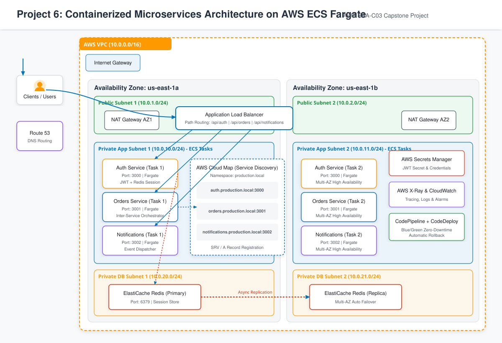
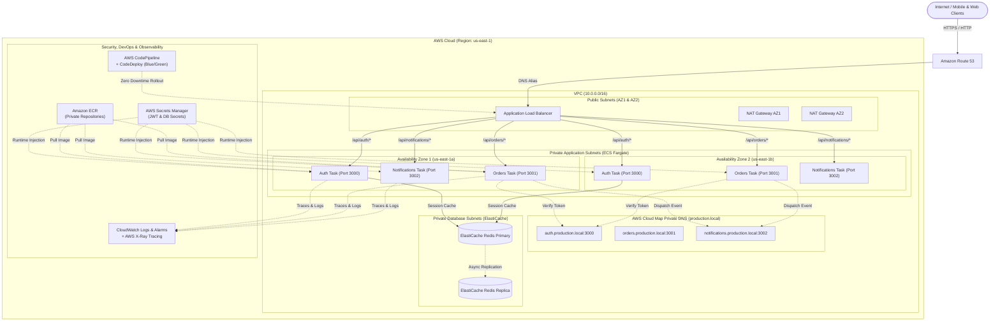
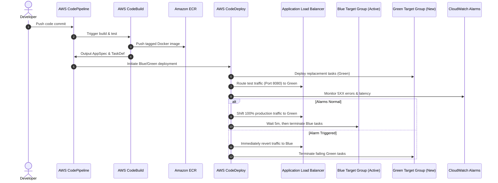

# AWS Solutions Architect – Associate Capstone Project
# Project 6: Containerized Microservices with ECS Fargate and Service Discovery

[](https://opensource.org/licenses/MIT)
[](https://www.terraform.io/)
[](https://aws.amazon.com/fargate/)
[](https://www.docker.com/)
[](https://nodejs.org/)

---

## 📌 Executive Summary

This graduation project implements an enterprise-grade, highly available, containerized microservices architecture on Amazon Web Services (AWS) using **Amazon ECS Fargate**, **AWS Cloud Map (Service Discovery)**, **Application Load Balancer (ALB)**, **Amazon ElastiCache (Redis)**, and **AWS Secrets Manager**.

The project migrates a monolithic Node.js application into three decoupled, stateless microservices:
1. **Auth Service (`/api/auth/*`)**: Handles user registration, authentication, JWT token issuance, and active session caching in ElastiCache Redis.
2. **Orders Service (`/api/orders/*`)**: Manages order creation and tracking, securely verifying tokens with the Auth service and triggering asynchronous events to the Notifications service via AWS Cloud Map private DNS.
3. **Notifications Service (`/api/notifications/*`)**: Receives events from internal microservices, delivering alerts and maintaining a delivery audit trail.

Deployment is automated through **Terraform Infrastructure as Code (IaC)** and an **AWS CodePipeline + AWS CodeDeploy** Blue/Green deployment strategy for zero downtime and automated rollback.

---

## 🏗️ Solution Architecture Diagram



### High-Level Architectural Flow (Mermaid)



---

## 🔑 Key AWS Services & Technical Implementation

| AWS Service | Architecture Role | Implementation Detail |
| :--- | :--- | :--- |
| **Amazon ECS (Fargate)** | Serverless Container Compute | Runs microservices with zero EC2 management; `awsvpc` network mode across multi-AZ private subnets. |
| **Amazon ECR** | Container Image Registry | Private image repositories with automated vulnerability scan-on-push and lifecycle expiration rules. |
| **Application Load Balancer (ALB)** | Layer 7 Traffic Ingress | Path-based routing rules directing external traffic (`/api/auth/*`, `/api/orders/*`, `/api/notifications/*`) to respective target groups. |
| **AWS Cloud Map** | Internal Service Discovery | Managed private DNS namespace (`production.local`) for low-latency inter-service communication without hairpinning through the ALB. |
| **Amazon ElastiCache (Redis)** | High-Performance Session Store | Multi-AZ replication group with automatic failover in isolated database subnets, caching JWT sessions and tokens. |
| **AWS Secrets Manager** | Centralized Secrets Lifecycle | Stores JWT secrets and internal service keys; injected securely at container startup via ECS task definitions (no hardcoded credentials). |
| **AWS CodePipeline & CodeDeploy** | CI/CD & Blue/Green Deployments | Canary and all-at-once Blue/Green traffic shifting with automatic rollback on CloudWatch alarms. |
| **AWS X-Ray & CloudWatch** | Distributed Tracing & Observability | End-to-end trace correlation (`X-Amzn-Trace-Id`) across microservices, centralized container logging, and metric alarms. |

---

## 🏛️ Well-Architected Framework Alignment

This solution aligns with the six pillars of the **AWS Well-Architected Framework**:

### 1. Operational Excellence
- **Infrastructure as Code**: Entire environment provisioned via modular Terraform templates.
- **Continuous Deployment**: Automated build and zero-downtime Blue/Green deployments via CodePipeline and CodeDeploy.
- **Centralized Logging & Tracing**: Container logs streamed to CloudWatch Log Groups; AWS X-Ray captures cross-service latency and distributed traces.

### 2. Security
- **Defense in Depth**: VPC with public subnets (ALB only), private application subnets (ECS tasks), and private database subnets (ElastiCache).
- **Least Privilege IAM**: Separate ECS Task Execution Roles (ECR pull, Secrets Manager read) and ECS Task Roles (X-Ray daemon access).
- **Secrets Management**: Dynamic runtime secret injection from AWS Secrets Manager prevents plaintext credential exposure.
- **Container Isolation**: Non-root container execution (`USER node`) and automated ECR container image vulnerability scanning on push.

### 3. Reliability
- **Multi-AZ Fault Tolerance**: ECS tasks distributed evenly across two Availability Zones (`us-east-1a` and `us-east-1b`).
- **ElastiCache Multi-AZ**: Redis replication group with automatic failover across isolated subnets.
- **Health Checks & Auto-Recovery**: ALB Target Group health checks (`/health`) automatically replace failing container tasks.

### 4. Performance Efficiency
- **Cloud Map Service Discovery**: Microservices communicate internally over private VPC DNS, eliminating ALB transit overhead and reducing latency.
- **In-Memory Caching**: ElastiCache Redis delivers sub-millisecond session validation, offloading database roundtrips.
- **Serverless Fargate Sizing**: Task CPU and memory right-sized (256 CPU, 512MB RAM) with linear horizontal scaling.

### 5. Cost Optimization
- **Fargate Compute on Demand**: Pay only for exact vCPU and memory consumed per second with no idle EC2 instances.
- **Single NAT Gateway Option**: Configurable for development environments to minimize VPC data processing and hourly charges.
- **ECR Lifecycle Policies**: Retains only recent image tags to eliminate stale container storage costs.

### 6. Sustainability
- **Managed Serverless Infrastructure**: AWS Fargate dynamically optimizes physical server utilization in AWS data centers, reducing carbon footprint compared to over-provisioned VMs.

---

## 📂 Repository Structure

```
aws-project/
├── .github/
│   └── workflows/
│       └── ci.yml               # GitHub Actions CI workflow for linting, testing & IaC
├── architecture/
│   └── architecture-diagram.svg # Scalable Vector Graphic solution architecture diagram
├── cicd/
│   ├── appspec-auth.yaml        # CodeDeploy Blue/Green AppSpec for Auth Service
│   ├── appspec-orders.yaml      # CodeDeploy Blue/Green AppSpec for Orders Service
│   ├── appspec-notifications.yaml # CodeDeploy Blue/Green AppSpec for Notifications
│   ├── buildspec.yml            # AWS CodeBuild instructions for ECR build & push
│   └── taskdef-template.json    # ECS Task Definition template for deployments
├── docker-compose.yml           # Complete local environment simulator with Redis & ALB
├── nginx/
│   └── nginx.conf               # ALB path routing simulator for local development
├── services/
│   ├── auth/                    # Auth Microservice (JWT, Redis session, PBKDF2)
│   │   ├── Dockerfile
│   │   ├── package.json
│   │   └── src/
│   │       ├── index.js
│   │       └── redisClient.js
│   ├── orders/                  # Orders Microservice (Cloud Map discovery to Auth & Notif)
│   │   ├── Dockerfile
│   │   ├── package.json
│   │   └── src/
│   │       ├── index.js
│   │       └── clients.js
│   └── notifications/           # Notifications Microservice (Event ingestion & audit)
│       ├── Dockerfile
│       ├── package.json
│       └── src/
│           └── index.js
├── terraform/                   # Production Terraform Infrastructure as Code
│   ├── alb.tf                   # Application Load Balancer & Target Groups
│   ├── cloud_map.tf             # AWS Cloud Map Private DNS Namespace
│   ├── codedeploy.tf            # Blue/Green CodeDeploy Configuration
│   ├── codepipeline.tf          # Automated CI/CD Pipeline
│   ├── ecr.tf                   # Amazon ECR Repositories & Lifecycle Rules
│   ├── ecs.tf                   # ECS Cluster, Task Definitions & Services
│   ├── elasticache.tf           # Multi-AZ ElastiCache Redis Cluster
│   ├── iam.tf                   # Task Execution, Task & CodeDeploy IAM Roles
│   ├── providers.tf             # HashiCorp AWS Provider Configuration
│   ├── secrets.tf               # AWS Secrets Manager Secret Definitions
│   ├── variables.tf             # Configurable Input Variables
│   ├── outputs.tf               # Infrastructure Endpoint Outputs
│   ├── terraform.tfvars.example # Example variable parameters
│   └── xray_cloudwatch.tf       # CloudWatch Alarms & X-Ray Tracing
├── scripts/
│   ├── test-local.sh            # Automated end-to-end integration test suite
│   ├── deploy-terraform.sh      # Terraform plan & apply helper script
│   └── cleanup.sh               # Teardown script for clean resource disposal
├── project.txt                  # Original graduation project requirements specification
└── README.md                    # Project documentation & execution guide
```

---

## 🚀 Quick Start: Local Simulation & Testing

You can spin up and verify the entire microservices mesh on your local machine using Docker Compose. The environment replicates the AWS Application Load Balancer (via Nginx reverse proxy) and ElastiCache Redis.

### 1. Start the Microservices Stack

```bash
docker compose up -d
```

### 2. Verify Container Status

```bash
docker compose ps
```

Expected output:
```text
NAME                    IMAGE                       STATUS                  PORTS
alb-gateway             nginx:alpine                Up (healthy)            0.0.0.0:8888->80/tcp
auth-service            aws-project-auth            Up (healthy)            3000/tcp
orders-service          aws-project-orders          Up (healthy)            3001/tcp
notifications-service   aws-project-notifications   Up (healthy)            3002/tcp
redis-cache             redis:alpine                Up                      0.0.0.0:6379->6379/tcp
```

### 3. Run the Automated Test Suite

Execute the pre-built test script:

```bash
./scripts/test-local.sh
```

Sample output:
```text
============================================================
 Starting End-to-End Microservices Test Suite on http://localhost:8888
============================================================

1. Verifying Microservices Health via ALB...
✔ PASS: Auth Service is healthy (Redis connected)
✔ PASS: Orders Service is healthy (Discovery configured)
✔ PASS: Notifications Service is healthy

2. Testing User Registration & Authentication (Auth Service)...
✔ PASS: User Registration Succeeded
✔ PASS: User Authentication & JWT Issuance Succeeded

3. Testing Inter-Service Communication via Cloud Map Service Discovery...
✔ PASS: Order Created & Cloud Map Notification Dispatched

4. Verifying Event Ingestion in Notifications Service...
✔ PASS: Notification Record Found in Service Log

5. Testing Order Lifecycle Operations...
✔ PASS: Order Cancelled & Update Notification Dispatched

============================================================
All 5 Test Suites Passed Successfully!
============================================================
```

---

## ☁️ Production Deployment on AWS

### Prerequisites
1. An AWS Account with administrative permissions for ECS, VPC, ECR, ALB, and IAM.
2. [AWS CLI v2](https://aws.amazon.com/cli/) configured (`aws configure`).
3. [Terraform >= 1.5.0](https://www.terraform.io/) installed.

### Step 1: Initialize and Plan Terraform

```bash
cd terraform
cp terraform.tfvars.example terraform.tfvars
terraform init
terraform plan
```

### Step 2: Provision Cloud Infrastructure

```bash
terraform apply -auto-approve
```

Terraform outputs the provisioned resources:
```text
alb_dns_name            = "microservices-fargate-alb-123456789.us-east-1.elb.amazonaws.com"
cloud_map_namespace     = "production.local"
ecr_repositories        = {
  auth-service          = "123456789012.dkr.ecr.us-east-1.amazonaws.com/microservices-fargate/auth-service"
  orders-service        = "123456789012.dkr.ecr.us-east-1.amazonaws.com/microservices-fargate/orders-service"
  notifications-service = "123456789012.dkr.ecr.us-east-1.amazonaws.com/microservices-fargate/notifications-service"
}
redis_primary_endpoint  = "microservices-fargate-redis.xxxxxx.ng.0001.use1.cache.amazonaws.com"
```

### Step 3: Build & Push Images to Amazon ECR

```bash
# Authenticate Docker to Amazon ECR
aws ecr get-login-password --region us-east-1 | docker login --username AWS --password-stdin <ACCOUNT_ID>.dkr.ecr.us-east-1.amazonaws.com

# Build and Push Auth Service
docker build -t <ACCOUNT_ID>.dkr.ecr.us-east-1.amazonaws.com/microservices-fargate/auth-service:latest ./services/auth
docker push <ACCOUNT_ID>.dkr.ecr.us-east-1.amazonaws.com/microservices-fargate/auth-service:latest

# Build and Push Orders Service
docker build -t <ACCOUNT_ID>.dkr.ecr.us-east-1.amazonaws.com/microservices-fargate/orders-service:latest ./services/orders
docker push <ACCOUNT_ID>.dkr.ecr.us-east-1.amazonaws.com/microservices-fargate/orders-service:latest

# Build and Push Notifications Service
docker build -t <ACCOUNT_ID>.dkr.ecr.us-east-1.amazonaws.com/microservices-fargate/notifications-service:latest ./services/notifications
docker push <ACCOUNT_ID>.dkr.ecr.us-east-1.amazonaws.com/microservices-fargate/notifications-service:latest
```

### Step 4: Verify Live AWS Deployment

Run the test suite against your ALB DNS endpoint:

```bash
./scripts/test-local.sh "http://<ALB_DNS_NAME>"
```

---

## 🔄 Blue/Green Deployment Workflow (CodeDeploy)



---

## 🧹 Resource Teardown

To avoid incurring ongoing AWS charges after evaluation:

```bash
./scripts/cleanup.sh
```

Or manually:
```bash
cd terraform
terraform destroy -auto-approve
```

---

## 👨‍💻 Project Information

- **Project**: AWS Solutions Architect – Associate Capstone Project (Project 6)
- **Author**: Ayman Aly Mahmoud
- **Topic**: Containerized Microservices with ECS Fargate and Service Discovery
- **License**: MIT

